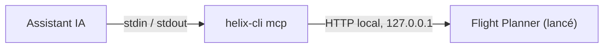

Les assistants IA comme Claude Desktop ou Cursor parlent **MCP** (Model Context Protocol). Avec le pont MCP de `helix-cli`, un tel assistant peut utiliser les mêmes 31 outils que la ligne de commande : lire l'état de la mission, ajouter une zone, régler les paramètres, calculer le plan, lancer le contrôle qualité, exporter.

## Comment ça marche

La commande `helix-cli mcp` est un pont. L'assistant la lance comme un programme, lui écrit des messages MCP (une ligne JSON par message sur son entrée standard) et lit les réponses (sur sa sortie standard). Le pont transmet chaque message au Flight Planner, qui doit être lancé et connecté.



Le pont trouve seul le port et le jeton d'accès, dans le même fichier que la ligne de commande. **La configuration de l'assistant ne contient aucun secret.** Si vous relancez l'application pendant que l'assistant est ouvert, le pont relit le fichier à l'échec suivant.

## Prérequis

- Le Flight Planner lancé, avec une session ouverte.
- Le **plan Pro**, qui inclut le MCP. Voir [Prérequis et licence](/fr/cli/demarrage/prerequis-et-licence).
- `helix-cli` installé et joignable. Voir [Installation](/fr/cli/demarrage/installation).

## Configurer l'assistant

Choisissez votre assistant, copiez le bloc et collez-le à l'endroit indiqué dans l'onglet.

<Tabs>
  <Tab title="Claude Desktop">
    ```json
    {"mcpServers":{"helix":{"command":"helix-cli","args":["mcp"]}}}
    ```

    À coller dans `claude_desktop_config.json`. Pour l'ouvrir : **Settings**, **Developer**, **Edit Config** (Réglages, Développeur, Modifier la config si Claude est en français). Le fichier se trouve dans `%APPDATA%\Claude\` sous Windows et dans `~/Library/Application Support/Claude/` sous macOS. Si le fichier contient déjà un objet `mcpServers`, ajoutez-y seulement l'entrée `helix`. Quittez complètement Claude Desktop, puis relancez-le.
  </Tab>
  <Tab title="Claude Code">
    ```sh
    claude mcp add --transport stdio helix -- helix-cli mcp
    ```

    À lancer dans un terminal, depuis le dossier de votre projet. Par défaut, le serveur n'est disponible que pour vous, dans ce projet. Ajoutez `--scope user` après `claude mcp add` pour l'avoir dans tous vos projets, ou `--scope project` pour écrire un fichier `.mcp.json` partagé avec votre équipe. Vérifiez avec `claude mcp get helix`, ou `/mcp` dans Claude Code.
  </Tab>
  <Tab title="Cursor">
    ```json
    {"mcpServers":{"helix":{"command":"helix-cli","args":["mcp"]}}}
    ```

    À coller dans `~/.cursor/mcp.json` pour avoir le serveur dans tous vos projets, ou dans `.cursor/mcp.json` à la racine d'un projet pour le limiter à ce projet. Si le fichier contient déjà un objet `mcpServers`, ajoutez-y seulement l'entrée `helix`.
  </Tab>
  <Tab title="VS Code">
    ```json
    {"servers":{"helix":{"type":"stdio","command":"helix-cli","args":["mcp"]}}}
    ```

    À coller dans `.vscode/mcp.json`, à la racine de l'espace de travail. Pour l'ouvrir : **Palette de commandes**, **MCP: Open Workspace Folder MCP Configuration**. Pour tous vos espaces de travail, utilisez plutôt **MCP: Open User Configuration**. VS Code nomme la clé de premier niveau `servers` et demande `type` : ce bloc n'est donc pas le même que les autres.
  </Tab>
</Tabs>

Vous pouvez aussi copier la configuration depuis l'application et la coller dans tout autre assistant qui lit `mcpServers` :

<Steps>
  <Step title="Copier la configuration depuis les Réglages">
    Dans le Flight Planner, ouvrez les **Réglages**, puis la section **Serveur**. Dans la carte **Serveur MCP (agent IA)**, sur la ligne **Assistants IA (MCP)**, cliquez sur **Copier la config IA**. Le bouton affiche **Copié ✓**.
  </Step>
  <Step title="La coller dans votre assistant">
    Collez le texte dans la configuration des serveurs MCP de votre assistant, à l'endroit que sa documentation indique.
  </Step>
  <Step title="Relancer l'assistant">
    Relancez l'assistant s'il le demande. Le serveur `helix` apparaît avec ses outils.
  </Step>
</Steps>

- `helix` est le nom sous lequel l'assistant liste le serveur.
- `command` et `args` lancent `helix-cli mcp`.

<Tip>
Si l'assistant indique qu'il ne peut pas lancer `helix-cli`, mettez le chemin complet de la commande dans `command` (sous Windows, le chemin de `helix-cli.exe` indiqué dans [Installation](/fr/cli/demarrage/installation)).
</Tip>

## La carte des Réglages

La carte **Serveur MCP (agent IA)** se trouve dans **Réglages**, section **Serveur**. Elle affiche :

- **État** : **Actif** (avec l'adresse locale et le nombre de requêtes), **Arrêté**, **Arrêté dans les Réglages**, **Add-on MCP ou CLI requis**, ou **Erreur** avec son code. Le bouton **Démarrer** ou **Arrêter** et le bouton **Relancer** agissent sur le serveur.
- **Assistants IA (MCP)** : le bouton **Copier la config IA**. Une fois cliqué, il affiche **Copié ✓**.
- **Scripts (CLI)** : le bouton **Doc**, qui ouvre la documentation de la ligne de commande.

La note sous **État** rappelle que le serveur démarre avec l'application, en local uniquement (127.0.0.1).

## Ce que voit l'assistant

- **Les outils :** les 31 outils de la [référence des commandes](/fr/cli/reference/missions-et-vols), avec leur description (en anglais) et le schéma de leurs arguments. Les outils qui ne font que lire sont signalés comme tels.
- **Une indication d'usage :** le serveur indique à l'assistant l'ordre habituel d'emploi : lister les missions, en ouvrir une, lire sa géométrie, sélectionner ou ajouter un élément, régler les paramètres, calculer le plan, lancer le contrôle qualité. Les distances sont en mètres, les angles en degrés, les coordonnées en WGS84, et les outils agissent sur l'élément actif.
- **Des erreurs qu'il peut lire :** quand un outil échoue, l'assistant reçoit le texte `CODE: message`, signalé comme une erreur, pour pouvoir corriger son appel. Un outil qui n'existe pas est signalé comme une erreur de protocole.
- **La progression :** pour les opérations longues (plan, contrôle qualité), un assistant qui le demande reçoit des notifications de progression.

Les versions du protocole acceptées sont `2025-06-18`, `2025-03-26` et `2024-11-05`.

<Warning>
Un assistant agit sur votre mission **comme vous le feriez** : les modifications apparaissent à l'écran, sont enregistrées avec la mission et ajoutées à l'historique. Il peut ajouter, déplacer et supprimer des éléments. Annulez-les avec **Ctrl+Z** dans l'application, ou avec l'outil [`history`](/fr/cli/reference/elements-et-geometrie#history).
</Warning>

## Sans le droit MCP

Si votre licence inclut la ligne de commande mais pas le MCP, l'application refuse **tous** les messages, dès l'initialisation de la session. L'assistant reçoit une erreur dont le message est :

```text
add-on addon.mcp requis par la licence
```

Si l'application est introuvable, le pont répond par une erreur dont le message est celui de la ligne de commande, qui commence par `helix-cli ne trouve pas AERO Flight Planner. Vérifiez que :` et se termine par `Adresse cherchée :` suivi des adresses cherchées. Il énumère les vérifications à faire : application lancée et connectée, licence, serveur démarré (voir [Dépannage](/fr/cli/aide/depannage)). Si l'adresse est trouvée mais que personne ne répond, le message est `AERO Flight Planner ne répond pas sur le port … (…). Il a peut-être été fermé : relancez-le et réessayez.`

## Tester le pont à la main

Vous pouvez vérifier le pont sans assistant. Envoyez-lui un `ping` :

```sh
echo '{"jsonrpc":"2.0","id":1,"method":"ping"}' | helix-cli mcp
```

Le pont répond par une ligne JSON-RPC dont le `result` est vide, puis s'arrête quand son entrée se termine. Pour voir la liste des outils, envoyez de la même façon `{"jsonrpc":"2.0","id":2,"method":"tools/list"}`.

## Voir aussi

- [Premières commandes](/fr/cli/demarrage/premieres-commandes)
- [Dépannage](/fr/cli/aide/depannage)
